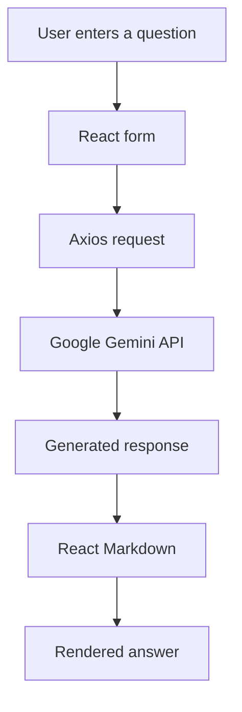

# Sampark AI

Sampark AI is a single-page question-and-answer interface built with React and Vite. Users enter a prompt, the app sends it to Google's Gemini API, and the response is rendered as Markdown.

<p align="center">
  
  
  
  
</p>

## Features

- Prompt submission through a simple chat-style form.
- Gemini-generated answers.
- Markdown rendering for formatted responses.
- Loading state while a response is being generated.
- Responsive layout styled with Tailwind CSS.

## Stack

- React 18
- Vite 5
- Axios
- React Markdown
- Tailwind CSS 3
- Google Gemini API

## Requirements

- Node.js 18 or later
- npm
- A Google AI Studio API key

## Setup

1. Clone the repository and enter the project:

   ```bash
   git clone https://github.com/Brajesh31/Sampark-AI.git
   cd Sampark-AI
   ```

2. Install dependencies:

   ```bash
   npm ci
   ```

3. Create a local environment file:

   ```bash
   cp .env.example .env
   ```

4. Set `VITE_GEMINI_API_KEY` in `.env` to a key created in [Google AI Studio](https://aistudio.google.com/app/apikey).

5. Start the development server:

   ```bash
   npm run dev
   ```

6. Open the local URL printed by Vite, usually `http://localhost:5173`.

## Available scripts

| Command | Purpose |
|---|---|
| `npm run dev` | Start the Vite development server |
| `npm run lint` | Run ESLint |
| `npm run build` | Create the production build in `dist/` |
| `npm run preview` | Preview the production build locally |

## Request flow



## Security warning

The current implementation calls Gemini directly from the browser. Vite exposes `VITE_*` variables in the client bundle, so this approach does **not** keep the API key secret. It is suitable only for a restricted development/demo key. For a public production deployment, move the Gemini request to a server-side API route, store the key in server environment variables, apply rate limits, and validate requests on the server.

A Gemini key was previously committed in source code and has been removed from the current version. **Revoke or rotate that exposed key in Google AI Studio.** Removing it from the latest commit does not erase it from Git history.

## Current scope and limitations

This repository is a prompt-and-response interface. It does not currently include user accounts, persistent chat history, a backend proxy, streaming responses, or automated frontend tests.

## Contributing

Read [CONTRIBUTING.md](CONTRIBUTING.md) before submitting a change. Please do not include API keys or other secrets in issues or pull requests.

## Security

See [SECURITY.md](SECURITY.md) for vulnerability reporting guidance.

## License

MIT. See [LICENSE](LICENSE).
