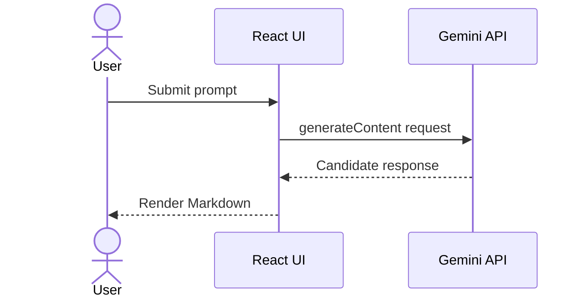

# Architecture

Sampark AI is a browser-only React application.

## Components

- `src/main.jsx`: mounts the React application and global stylesheet.
- `src/App.jsx`: owns the prompt, loading, and response state; calls Gemini with Axios; renders Markdown.
- `src/index.css`: global styles and Tailwind entry point.
- `index.html`: document metadata and Vite entry point.

## Request flow

There is currently no application backend or persistent storage. The browser-side API key is visible in the built assets; a server-side proxy is required before a public production launch.
